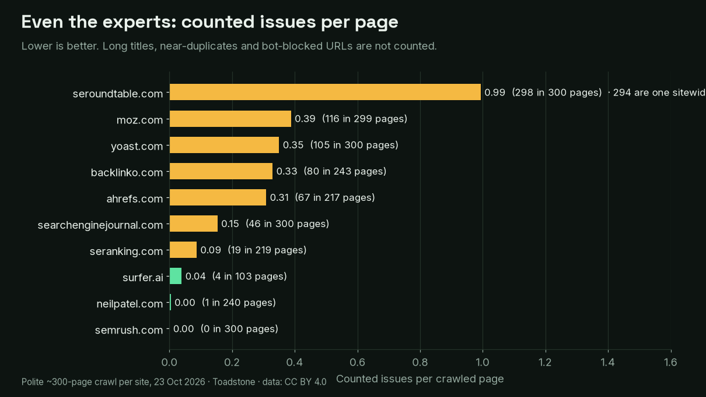
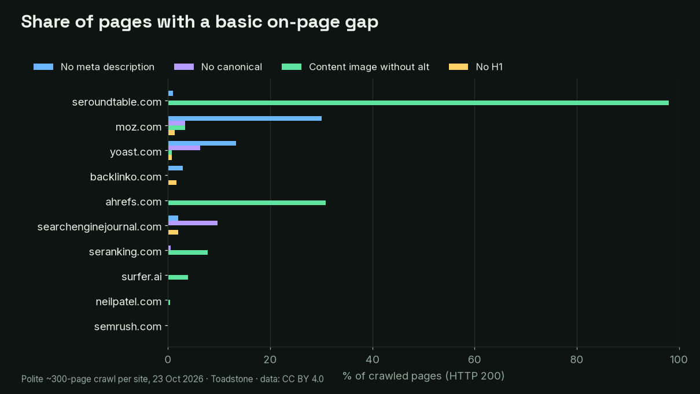
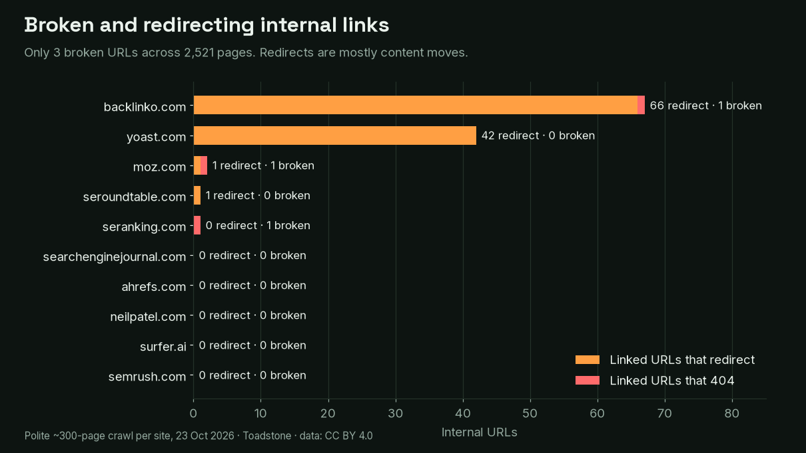
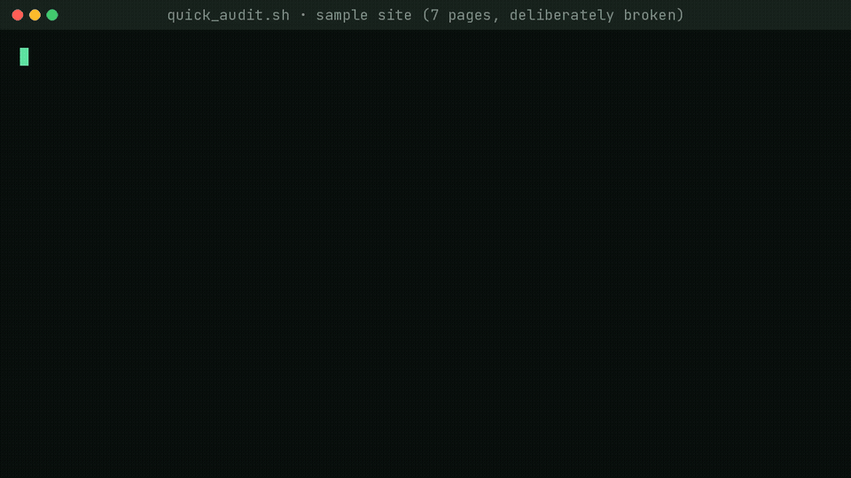

# We crawled 10 of the best-known SEO sites. They were mostly excellent.

**Data report, crawled 23 Oct 2026 · 2,521 pages · 15,326 URLs · 18,341 requests**
Landing page with the animated story: **https://spcaeo.github.io/seo-experts-crawl-2026/**



We pointed a polite crawler at ten well-known SEO and marketing sites, about 300 pages each, and counted only things we could confirm. These are teams that write the playbooks, and most of them are in great shape. What slips through is ordinary busy-team stuff, and it is the same stuff that is probably on your site.

All of the data here is free to reuse under CC BY 4.0. Every number in this README comes from the CSVs in [`data/`](data/), and every example quoted was re-checked with curl.

## Key findings

1. **Only 3 broken URLs in 2,521 pages.** One per site on three sites: a placeholder link left in a Backlinko article, a Moz guide link that now returns 404, and one missing image on SE Ranking.
2. **Semrush's blog came back clean on every check we count** (0 issues in 300 pages). Neil Patel had 1 in 240 pages and Surfer 4 in 103.
3. **One template line can be most of a site's total.** On Search Engine Roundtable a single sitewide badge image has no `alt` attribute, and that one image is on 294 of the 298 counted issues. One edit in one template fixes it.
4. **Detours add up.** Backlinko links to 66 internal URLs that redirect first, and 56 of those end on searchengineland.com. Both sites belong to Semrush, so this looks like content moving between sister brands, not a mistake. It just means an extra hop on each link. Yoast has 42 more.
5. **Missing meta descriptions cluster.** 90 of Moz's 299 pages have none (for example `/learn/seo/google-eat`, while its sibling `/learn/seo/what-is-seo` has one). Yoast has 40.
6. **1,930 of 2,521 pages (77%) pass all five page-level checks** (meta description, canonical, one H1, alt text on content images). Fixing templates first clears the biggest share.

Across all ten sites we counted **736 issues, 29.2 per 100 pages**. Without the one Search Engine Roundtable badge it is 442, or 17.5 per 100.



## Per-site results

Sorted from fewest to most counted issues per 100 pages. "Counted issues" is the sum of the seven columns to the right (broken URLs, linked URLs that redirect, no meta description, no canonical, no H1, 2+ H1, content image without alt). Click through to [`data/sites.csv`](data/sites.csv) for more columns.

| Site | Pages (HTTP 200) | Counted issues | per 100 pages | Broken URLs | Linked URLs that redirect | No meta desc. | No canonical | No H1 | 2+ H1 | Content img w/o alt |
|---|--:|--:|--:|--:|--:|--:|--:|--:|--:|--:|
| semrush.com | 300 | 0 | 0.0 | 0 | 0 | 0 | 0 | 0 | 0 | 0 |
| neilpatel.com | 240 | 1 | 0.4 | 0 | 0 | 0 | 0 | 0 | 0 | 1 |
| surfer.ai | 103 | 4 | 3.9 | 0 | 0 | 0 | 0 | 0 | 0 | 4 |
| seranking.com | 219 | 19 | 8.7 | 1 | 0 | 0 | 1 | 0 | 0 | 17 |
| searchenginejournal.com | 300 | 46 | 15.3 | 0 | 0 | 6 | 29 | 6 | 5 | 0 |
| ahrefs.com | 217 | 67 | 30.9 | 0 | 0 | 0 | 0 | 0 | 0 | 67 |
| backlinko.com | 243 | 80 | 32.9 | 1 | 66 | 7 | 0 | 4 | 2 | 0 |
| yoast.com | 300 | 105 | 35.0 | 0 | 42 | 40 | 19 | 2 | 0 | 2 |
| moz.com | 299 | 116 | 38.8 | 1 | 1 | 90 | 10 | 4 | 0 | 10 |
| seroundtable.com | 300 | 298 | 99.3 | 0 | 1 | 3 | 0 | 0 | 0 | 294 |
| **All 10** | **2,521** | **736** | **29.2** | **3** | **110** | **146** | **59** | **16** | **7** | **395** |



## What we did not count, and why

We would rather under-count than call something an error that is not. The full list with raw flag numbers is in [`data/excluded-flags.csv`](data/excluded-flags.csv).

- **Bot-wall answers (401/403/429) and no-response URLs.** 177 URLs answered 401/403/429 (Moz 119, Backlinko 56, Search Engine Roundtable 2) and 3 did not respond. A crawler being politely declined is not a broken link.
- **Cross-domain canonicals.** Often correct, for syndicated content. Informational only.
- **Long titles (over 60 characters).** 633 pages. That is an editorial choice, not an error.
- **Near-duplicate pages.** 91 pages, mostly category and archive listings, which is normal for publishers.
- **Images that are not content.** 1×1 pixels and trackers are ignored. `alt=""` counts as having alt text, because that is the right markup for decorative images.
- **Anything we could not re-verify.** Examples marked in the story were re-requested with curl at 19:45–19:48 ET ([`data/verified-examples.csv`](data/verified-examples.csv), [`data/evidence/curl-log.jsonl`](data/evidence/curl-log.jsonl)).

## Method

- **When:** crawls ran about 18:50–19:27 ET on 23 Oct 2026 (America/Toronto, UTC-4).
- **How much:** up to 300 pages or 25 minutes per site, whichever came first. Four sites (Ahrefs, SE Ranking, Neil Patel and Moz) ran into the 25-minute cap and stopped at 217–299 pages. Surfer (103 pages), Backlinko (243) and Yoast (300) finished their scope earlier. Counts describe the pages reached, not the whole site. Treat the numbers as a sample, not a census.
- **How politely:** at most 2 requests per second, 2 concurrent connections, robots.txt respected, no sitemap fetching, no login or form interaction.
- **Who we said we were:** `ToadstoneBot/1.0 (+https://github.com/spcaeo/toadstone; polite research crawl, <=2 req/s)`.
- **Re-checks:** the quoted examples were re-requested with curl, one request at a time, at least 1 second apart.
- **What we publish:** public page metadata only (status codes, titles' length, presence of meta, canonical and H1, image alt counts). No page text, no cookies, no response headers. The raw crawler JSON is not published.

Full details: [methodology page](https://spcaeo.github.io/seo-experts-crawl-2026/methodology.html) · [data dictionary](data/DATA-DICTIONARY.md).

## Reproduce it

```bash
git clone https://github.com/spcaeo/seo-experts-crawl-2026 && cd seo-experts-crawl-2026
python3 -m venv .venv && . .venv/bin/activate && pip install -r requirements.txt

# 1. Rebuild the summaries and charts from the published CSVs
python scripts/build_web_data.py && python scripts/make_charts.py && python scripts/build_page.py

# 2. Re-verify the headline examples with curl (one request at a time)
python scripts/verify_examples.py

# 3. Crawl a site yourself, politely (clone and install Toadstone first, see its README)
git clone https://github.com/spcaeo/toadstone ../toadstone
TOADSTONE_REPO=../toadstone python scripts/ts_crawl.py https://example.com out.json --max 300 --delay 0.5 --concurrency 2
```

The exact crawl command for each site is on the [methodology page](https://spcaeo.github.io/seo-experts-crawl-2026/methodology.html#reproduce). Because these are live sites, your numbers will differ from ours. That is the point of crawling your own site regularly.

## Media

| File | What it is |
|---|---|
| [`docs/media/issues-race.mp4`](docs/media/issues-race.mp4) | 33 s, 1080×1080 race of counted issues as the crawl progressed (captions burned in; [VTT](docs/media/issues-race.vtt)) |
| [`docs/media/landing-scroll.mp4`](docs/media/landing-scroll.mp4) | 27 s, 1920×1080 scroll through the landing page |
| [`docs/media/quick-audit-terminal.mp4`](docs/media/quick-audit-terminal.mp4) / [`.gif`](docs/media/quick-audit-terminal.gif) | 14 s terminal clip: the quick audit on a small labelled sample site |
| `docs/media/og-image.png`, `card-1…4*.png` | Social preview and four share cards (1200×630) |



## This page passes its own audit

We ran Toadstone on the landing page, methodology and FAQ before publishing, with the same crawl we used on everyone else (copy at [`self-audit/`](self-audit/)).

- **Served with security headers** (`scripts/self_audit.sh --headers`): **zero** findings.
- **Served on GitHub Pages:** the only remaining findings are the four security *headers* (Content-Security-Policy header, X-Content-Type-Options, X-Frame-Options, Permissions-Policy). GitHub Pages does not let you set response headers. The page ships a strict `<meta>` Content-Security-Policy and uses no inline scripts or styles, so it works the same way; if you host it yourself, add the headers and it is clean.
- **Sitemap and robots.txt on github.io:** on a project page, `/robots.txt` and `/sitemap.xml` at the domain root belong to GitHub, not to this repo. Our copies live in `docs/`, the page declares `<link rel="sitemap">`, and the self-audit ran them at the origin root as they would be on a custom domain.
- **Dates:** `lastmod` in the sitemap and JSON-LD is set when the page is built. If you deploy more than 24 hours after building, rebuild with `PAGE_STAMP=<iso time> python scripts/build_page.py` so the dates match the `Last-Modified` header.
- **Localhost response times** are measured with the polite throttle turned off, since our own throttle delay would otherwise look like a slow server.

## Disclosure

Toadstone is our tool: a free, self-hosted, source-available (Elastic License 2.0) SEO crawler ([github.com/spcaeo/toadstone](https://github.com/spcaeo/toadstone)). We are not affiliated with any site we crawled, and none of them asked us to do this. If you spot something that is wrong or out of date on your site's row, open an issue and we will re-check it and correct the data.

## Licences

- Data, charts, media and text: **CC BY 4.0** ([`LICENSE-DATA`](LICENSE-DATA)). Please credit "Toadstone SEO experts crawl 2026" with a link.
- Scripts: **MIT** ([`LICENSE-CODE`](LICENSE-CODE)).

## Repository map

```
README.md            this report
data/                CSV + JSON data, verified examples, evidence, DATA-DICTIONARY.md
charts/              chart PNGs (also in docs/media)
docs/                landing page (GitHub Pages), methodology, FAQ, media, copies of the data
scripts/             build, chart, video, verify and self-audit scripts
self-audit/          results of running Toadstone on this site
story/               article, LinkedIn, X thread, Reddit post and press pitch drafts
```
