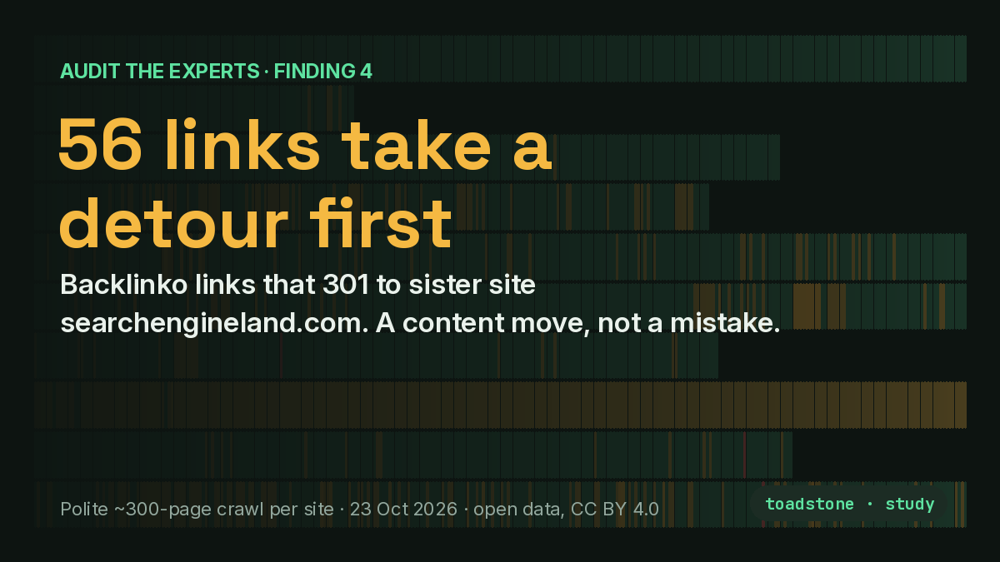

# We crawled 10 of the best-known SEO sites. They were mostly excellent.

*Draft for Medium, dev.to and LinkedIn Articles. Canonical home: https://spcaeo.github.io/seo-experts-crawl-2026/. Hero image: `docs/media/og-image.png`. Inline images: `chart_issues_per_page.png`, `card-2-template.png`, `card-4-redirects.png`. Embed or link: `issues-race.mp4`.*

---

I wanted to know something simple: do the people who write the SEO playbooks follow them?

So on 23 October 2026 I pointed a polite crawler at ten of the best-known SEO sites (Semrush, Ahrefs, Moz, Backlinko, Yoast, Search Engine Journal, Search Engine Roundtable, Neil Patel, SE Ranking and Surfer) and looked at about 300 pages from each. That came to 2,521 pages, 15,326 URLs and 18,341 requests, at no more than two requests per second, with robots.txt respected.

The short answer: **they are in very good shape.** What slipped through is the ordinary, busy-team kind of thing that is probably on your site too.

## The bar is high

Across all 2,521 pages we found **three broken URLs**. Three. One was a placeholder link left in a Backlinko article, one was a Moz guide link that now returns a 404, and one was a missing image on SE Ranking. No site had more than one.

And 1,930 of those 2,521 pages (77%) passed all five page-level basics: a meta description, a canonical, exactly one H1, and alt text on content images.

Semrush's blog came back **clean on every check we count: 0 issues in 300 pages.** Neil Patel had one in 240 pages. Surfer had four in 103.

## The slip that was one line

The most striking number in the data is on Search Engine Roundtable. Of 298 counted issues on the site, **294 are the same one**: a small "preferred source" badge image that appears on nearly every page and has no `alt` attribute.

That is the whole lesson in a single example. One image in one template is 294 pages. One edit fixes all of them. Nobody wrote 294 pages with a mistake. They wrote one template.

If you take only one thing from this: **fix templates before you fix pages.** A sitewide badge, a header logo, a related-posts block. Check those first.

## Detours add up

Backlinko links to 66 internal URLs that now redirect before they reach a page. Of those, **56 end on searchengineland.com**.

I do not think that is a mistake. Both sites belong to Semrush, and this looks like content moving between sister brands. But it is a useful picture of how redirects pile up after a move: every old link is still there, and every one now costs an extra hop. Yoast has 42 of the same kind after its own content changes.

Search engines follow redirects fine. The point is that you do not have to keep paying for them. A quick find-and-replace on internal links makes them go straight to their destination.

## Metadata gaps cluster

Where meta descriptions were missing, they were missing together. 90 of Moz's 299 pages had none (for example `/learn/seo/google-eat`, while its sibling `/learn/seo/what-is-seo` has one). Yoast had 40. Search Engine Journal had 29 pages without a canonical tag.

These are the gaps that open when a new page type or a new CMS template goes out without the same head tags as the old one. You rarely notice by browsing, but a crawl shows them immediately.

## What we did not count

I would rather under-count than call something an error that is not. These were left out on purpose:

- **Bot walls.** 177 URLs answered with 401, 403 or 429, mostly Moz and Backlinko. A site politely declining a crawler is not a broken link.
- **Cross-domain canonicals.** Often correct, for example on syndicated content.
- **Long titles.** 633 pages have a title over 60 characters. That is an editorial choice.
- **Near-duplicates.** 91 pages, mostly archive and category listings, which is normal for publishers.
- **Decorative images.** `alt=""` is correct markup for them, so we treat it as present.

Every example in this post was re-requested with curl before I wrote it down. The evidence log is in the repo.

## How I kept it fair

A crawl can make anyone look bad if you let it, so I set some rules before I looked at a single result.

First, page-level checks only run on pages that returned a normal 200 HTML response. Second, "broken" means 404, 410 or a server error, nothing else. Third, every headline example gets re-fetched by hand, with the request, status and a short HTML snippet saved to the evidence log. If I could not reproduce it, it did not make the story.

I also tried to keep the crawl itself polite: a clear user agent that says who I am and links to the project, no more than two requests per second, two connections at a time, and no logins or forms. The whole run took about 37 minutes of wall-clock time, with several sites crawled in parallel.

## A fix list you can do this week

If you only have an afternoon, this is the order I would work in, based on what moved the numbers most:

1. Find any sitewide image (badge, logo, banner) that has no alt text. Add it once in the template.
2. Search your content for placeholder or staging links and for links to guides you renamed or retired.
3. Replace internal links that redirect with the final URL. Start with your most-linked pages.
4. Compare a few pages of each type against each other. If one type is missing a meta description or canonical, fix the template.
5. Crawl again and save the result, so the next regression is visible.

## What I would take away

1. **Crawl your own site on a schedule.** If teams that live and breathe SEO still collect a placeholder link or a template badge, so will yours.
2. **Look for the template first.** If one issue shows up on hundreds of pages, it is almost certainly one line.
3. **After a move, update internal links.** Redirects are a safety net, not a destination.
4. **Be generous with other people's sites.** Everyone in this study ships under deadlines. A crawl reads what the browser hides. It is not a verdict on anyone's work.

## Caveats

This is a sample. Four sites (Ahrefs, SE Ranking, Neil Patel and Moz) hit my 25-minute cap before they reached 300 pages, so their numbers cover the pages reached, not the whole site. Live sites change daily, so your own crawl will differ from mine. I published only public page metadata: no page text, no headers, no cookies.

## Full disclosure

The crawler is mine. [Toadstone](https://github.com/spcaeo/toadstone) is a free, self-hosted, source-available (Elastic License 2.0) SEO crawler. I ran it on the study's own landing page before publishing, and the page passes its own audit: zero findings when served with security headers. On GitHub Pages only the four security-header findings remain, because Pages does not let you set response headers.

I am not affiliated with any of the ten sites, and none asked for this.

## Get the data

Everything is CC BY 4.0: per-site and per-page CSVs, the verified examples with curl evidence, the Backlinko redirect list, and a data dictionary. The animated version of this story, with the issue race, the 300-cell page grid and the terminal clip, is at **https://spcaeo.github.io/seo-experts-crawl-2026/**. The repo is at https://github.com/spcaeo/seo-experts-crawl-2026.

If a number for your site looks wrong, tell me and I will re-check it and fix the data.

*— Rakesh Patel*
